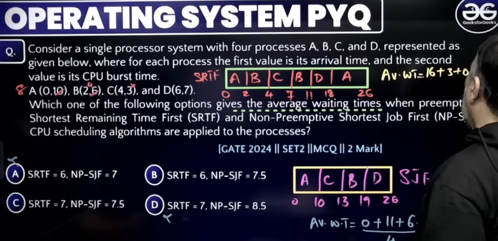
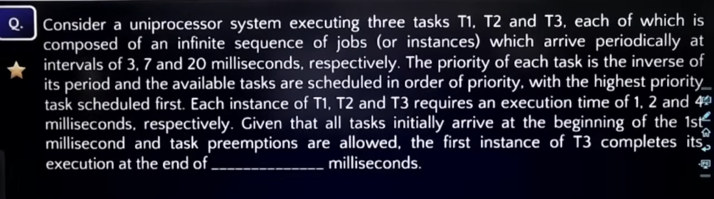
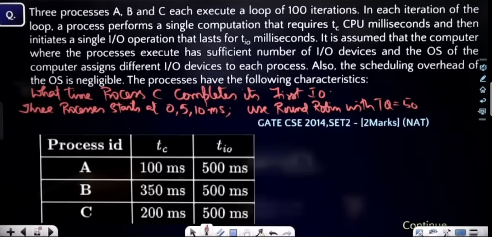
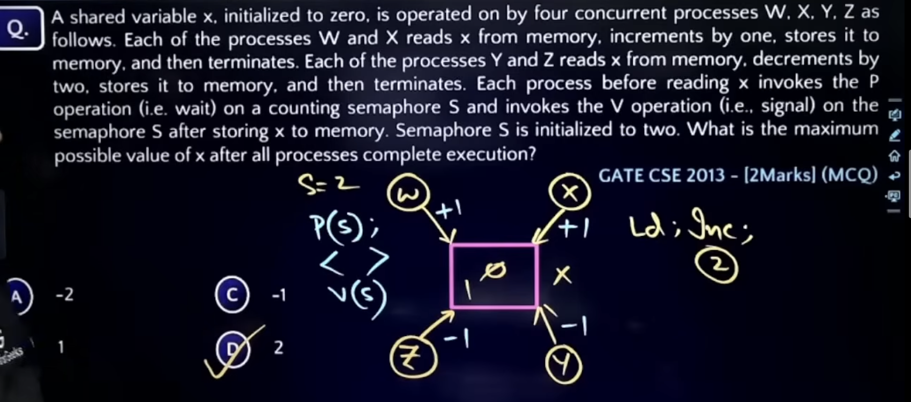
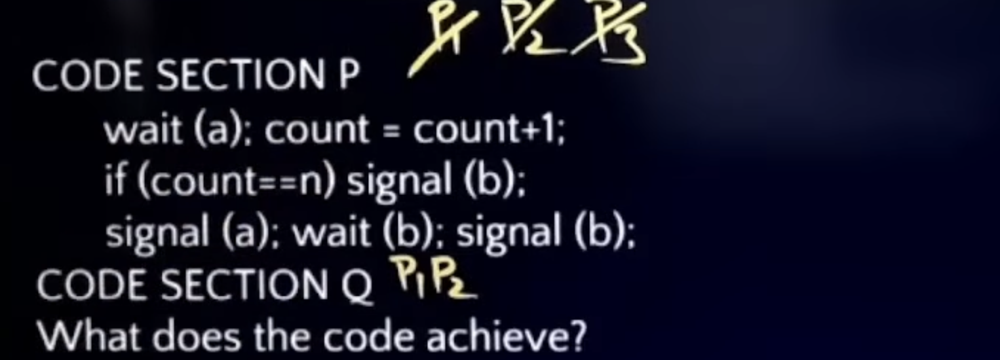
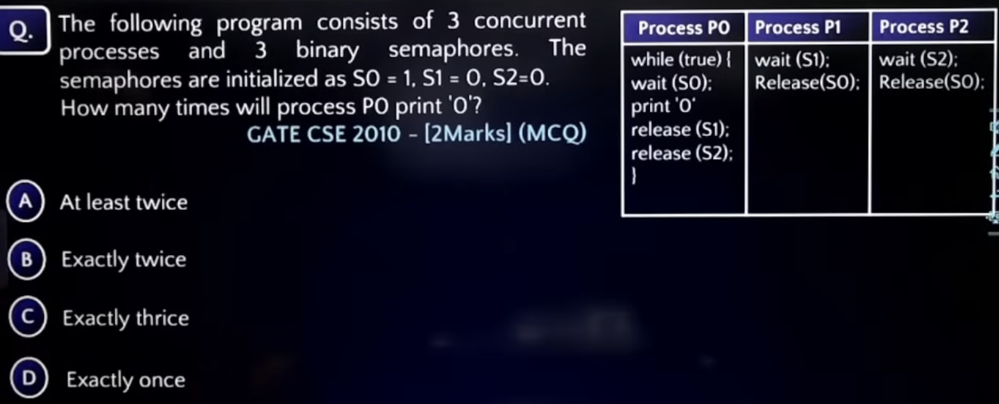
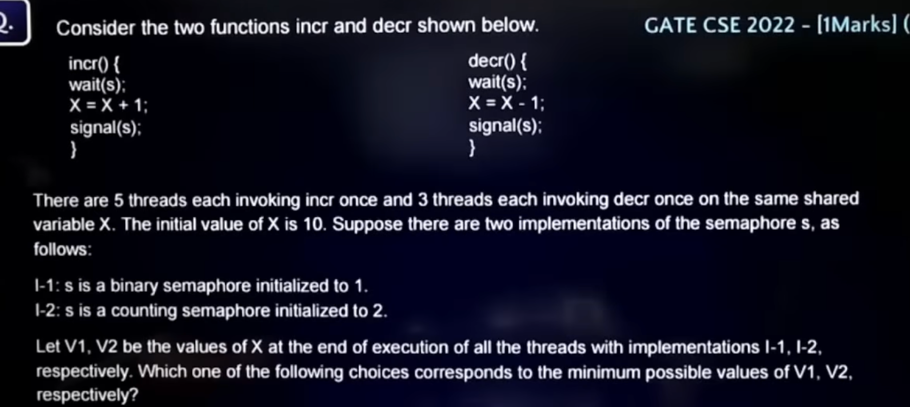
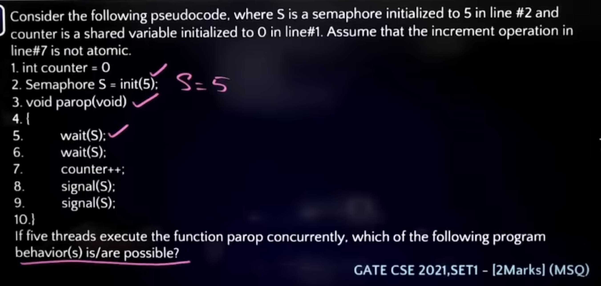
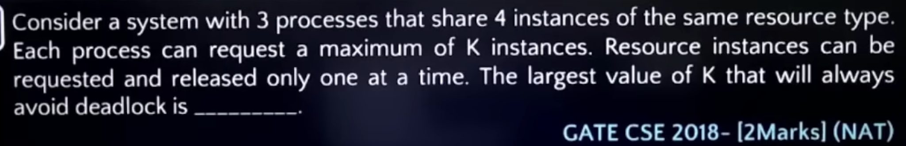
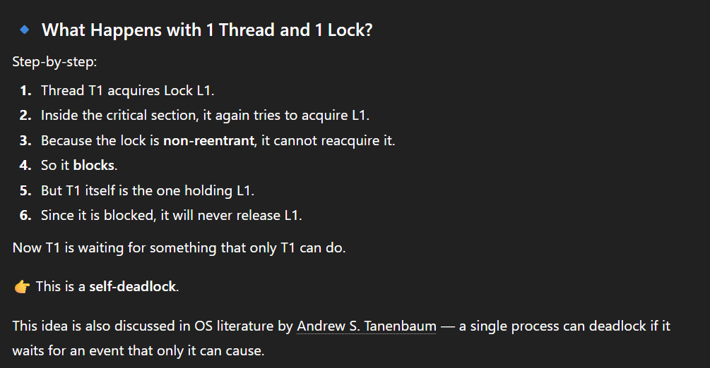

# OS Scheduling:

> The waiting time for preemptive is calaculated by seeing when CPU was allocated - AT and also if it was premeted and watited for more time.

# Context Switching between Threads of same process :
> Thread Context: Each thread has its own PC, Stack, Stack Pointer and CPU Registers.
> Shared by threads of the same process: Code, Data, Heap, Address Space/Page Table and open files/resources.
- Therefore:
- Thread switch within SAME process:
PC                  → Save/Restore ✅
Stack Pointer       → Save/Restore ✅
General Registers   → Save/Restore ✅
Page Table / PTBR   → No change    ❌

# CPU Scheduling & Starvation
| Algorithm                    | Starvation? | Why?                                                   |
| ---------------------------- | ----------- | ------------------------------------------------------ |
| **FCFS / FIFO**              | ❌ No        | Every process eventually gets its turn                 |
| **Round Robin (RR)**         | ❌ No        | Every process gets CPU for a time quantum              |
| **Priority Scheduling**      | ✅ Yes       | Low-priority processes may keep waiting                |
| **Shortest Job First (SJF)** | ✅ Yes       | Long jobs may keep waiting if short jobs keep arriving |

# CPU Scheduling 
1. Arrival Time (AT)
Time at which a process enters the ready queue.

2. Burst Time (BT)
Total CPU execution time required by a process.

3. Completion Time (CT)
Time at which the process finishes execution.

4. Turnaround Time (TAT)
Total time from arrival to completion.
> TAT = CT-AT.
- It includes both waiting time + CPU execution time.
> TAT=WT+BT

5. Waiting Time (WT)
- Time a process spends waiting in the Ready Queue for CPU.

6. Response Time (RT)
- Time from process arrival until it gets the CPU for the first time.
> RT=First CPU Start Time−AT

# IMP CONCEPT:

- AT is before start of 1 sec and answer is start of 13th sec or end of 12th sec.

# 

# User-Level Threads vs Kernel-Level Threads
| Feature                 | **User-Level Threads (ULT)**                                                | **Kernel-Level Threads (KLT)**                            |
| ----------------------- | ----------------------------------------------------------------------------| --------------------------------------------------------- |
| **Managed by**          | User-level thread library                                                   | Operating system kernel                                   |
| **Kernel awareness**    | Kernel does **not know** individual threads                                 | Kernel **knows and manages** threads                      |
| **Creation**            | Faster                                                                      | Slower                                                    |
| **Context switching**   | Faster, because kernel is not involved                                      | Slower, requires kernel involvement                       |
| **System calls**        | A blocking system call can block the **entire process**                     | Only the calling thread is blocked                        |
| **Multicore execution** | Usually cannot achieve true parallelism if kernel sees only one process     | Threads can run **simultaneously on multiple CPUs/cores** |
| **Scheduling**          | Thread library schedules threads                                            | Kernel schedules threads                                  |
| **Overhead**            | Low                                                                         | Higher                                                    |
| **Portability**         | More portable                                                               | More OS-dependent                                         |
| **Implementation**      | Easier                                                                      | More complex                                              |
| **Example**             | POSIX threads implemented entirely in user space, some green-thread systems | Windows threads, Linux kernel threads                     |

# 

> Since IO is sufficent => all processes can do io at same time.

# SYNC ALGOS:

## 
> Strict alternation is a synchronization method where processes are forced to enter the critical section strictly in turns, regardless of whether the other process actually wants to enter.

- Key difference from Peterson's algorithm:
Strict alternation gives the turn unconditionally, whereas Peterson's algorithm considers whether the other process actually wants to enter.

## SUMMARY :
| Algorithm / Technique      | Basic Idea                                                                | What it prevents / solves                              | Key limitation                               |
| -------------------------- | ------------------------------------------------------------------------- | ------------------------------------------------------ | -------------------------------------------- |
| **Strict Alternation**     | Processes enter CS strictly one after another using `turn`                | **Mutual exclusion**                                   | ❌ Fails **Progress**                         |
| **Simple Flag Algorithm**  | Each process sets a flag saying “I want to enter”                         | Attempts **mutual exclusion**                          | ❌ Can cause **deadlock** if both raise flags |
| **Peterson's Algorithm**   | `flag[] + turn`                                                           | **Mutual exclusion + Progress + Bounded Waiting**      | Only 2 processes; busy waiting               |
| **Bakery Algorithm**       | Processes take **ticket numbers** like a bakery                           | **Mutual exclusion + starvation**                      | More overhead; busy waiting                  |
| **Test-and-Set**           | Atomic hardware instruction to acquire a lock                             | **Race conditions / mutual exclusion**                 | Busy waiting                                 |
| **Compare-and-Swap (CAS)** | Atomically compares a value and changes it                                | **Race conditions / mutual exclusion**                 | Busy waiting possible                        |
| **Semaphore**              | Integer variable controlled by `wait()` and `signal()`                    | **Mutual exclusion, race conditions, synchronization** | Incorrect use can cause deadlock             |
| **Mutex**                  | Lock allowing only one thread at a time                                   | **Race conditions / mutual exclusion**                 | Doesn't solve every synchronization problem  |
| **Monitor**                | High-level construct combining shared data + procedures + synchronization | **Race conditions / mutual exclusion**                 | Language/runtime support required            |

# 

> Both enter CS at same time and will update value to the updated value by 1.

# 

> Wait on b will stuck the process since semaphore b = 0 => this happens till count==n and after that the code section Q will be processed in reverse order as they are in stack.

# For at least one P operation to remain blocked, the total available semaphore units must be insufficient for all 20 P operations, even after all 12 V operations.

> S + 12 < 20
=> S < 8 or S = 7.

# 

> only the first process has while so only it can run again rest all happen only once but if p2 happens after p1 then only twice O is printed but if p2 happens after p0 and p1 also after p0 then thrice.

> concurrent processes means the processes are active during the same period of time, and the OS can interleave their execution.

# 

> in case of counting semaphore if 2 threads enter at same time let the dec op loose the race condition and let all inc happen then dec writes whic will be 9 then other 2 dec ops => 7 min value.
> This happens cz X=X+1 is not a atmoic op.

1. Binary semaphore:

- 3dec + 5inc => 10+5-3=12 final value.

2. Counting semaphore:
    1. dec => 9 BUT DONT WRITE TO MEM YET
    2. inc => 11
    3. inc => 12
    4. inc => 13
    5. inc => 14
    6. inc => 15
    now 1st dec writes => X = 9 
    7. dec => 8
    8. dec => 7

## practice q on same

# 

- Given
Processes: n=3
Resource instances: R=4
Maximum demand of each process: K
Resources are allocated one at a time

=> WORST CASE WOULD BE EVERY PROCESS HAS K-1 RESOURCES AND IS WAITING FOR 1 MORE 
=> 3*(K-1) + 1 = 4
=> K=2;

# 
| Term              | Meaning                                                              |
| ----------------- | -------------------------------------------------------------------- |
| **Safe State**    | There is a guaranteed sequence in which **all processes can finish** |
| **Unsafe State**  | No such guaranteed sequence exists; **deadlock may occur**           |
| **Deadlock**      | Processes are **actually stuck forever**                             |
| **Deadlock-free** | System avoids a state where processes are permanently stuck          |

# A multithreaded program P executes with x number of threads and uses y number of locks for ensuring mutual exclusion while operating on shared memory locations. All locks in the program are non-reentrant, i.e., if athread holds a lock l, then it cannot re-acquire lock l without releasing it. If a thread is unable to acquire a lock, it blocks until the lock becomes available. The minimum value of x and the minimum value of y together for which execution of P can result in a deadlock are:

https://youtu.be/d8Y_3e7iguI?t=7880